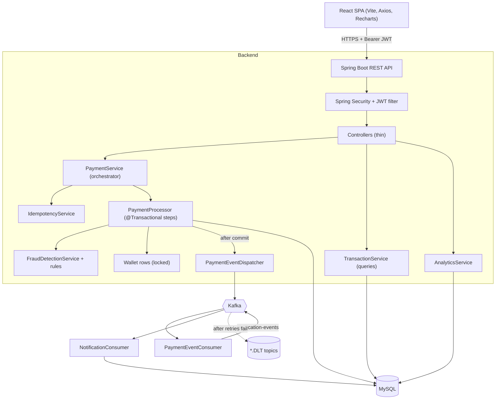
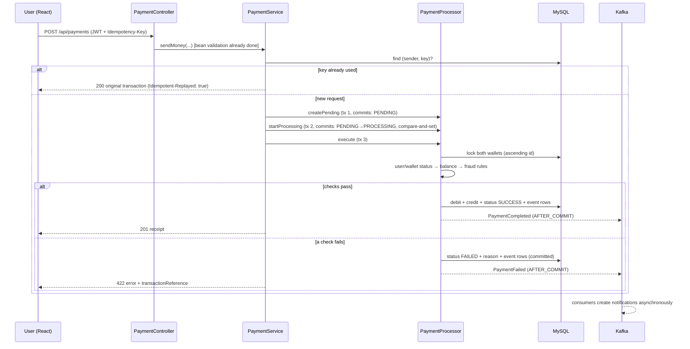
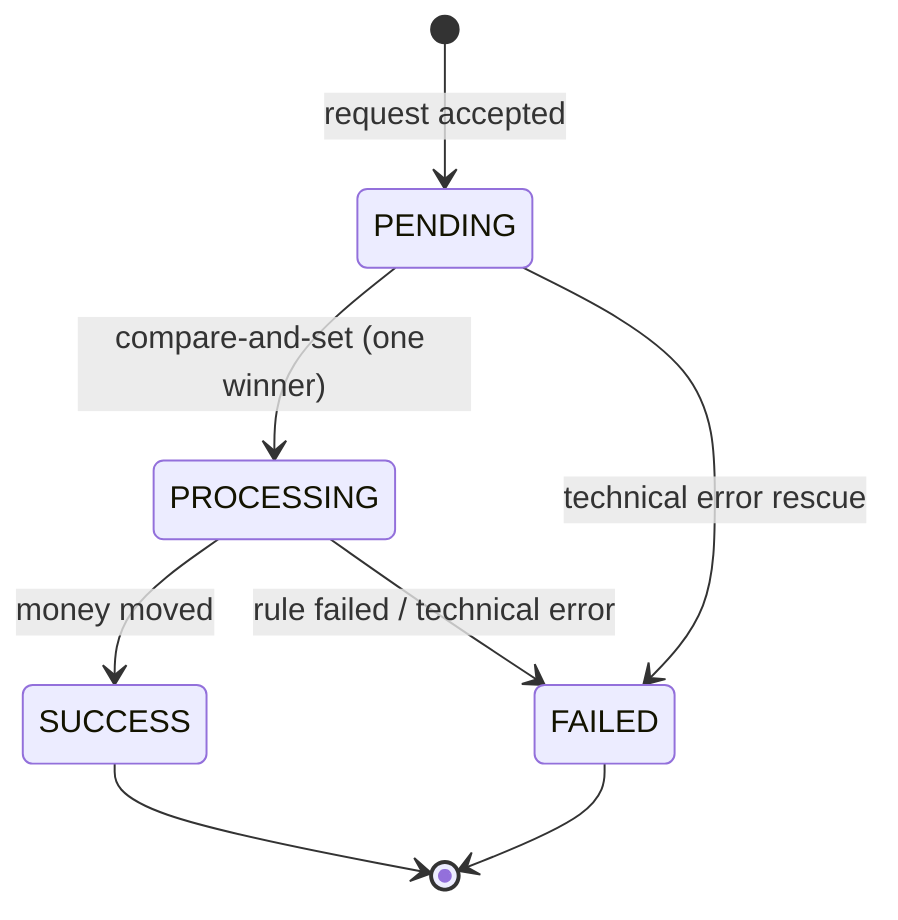
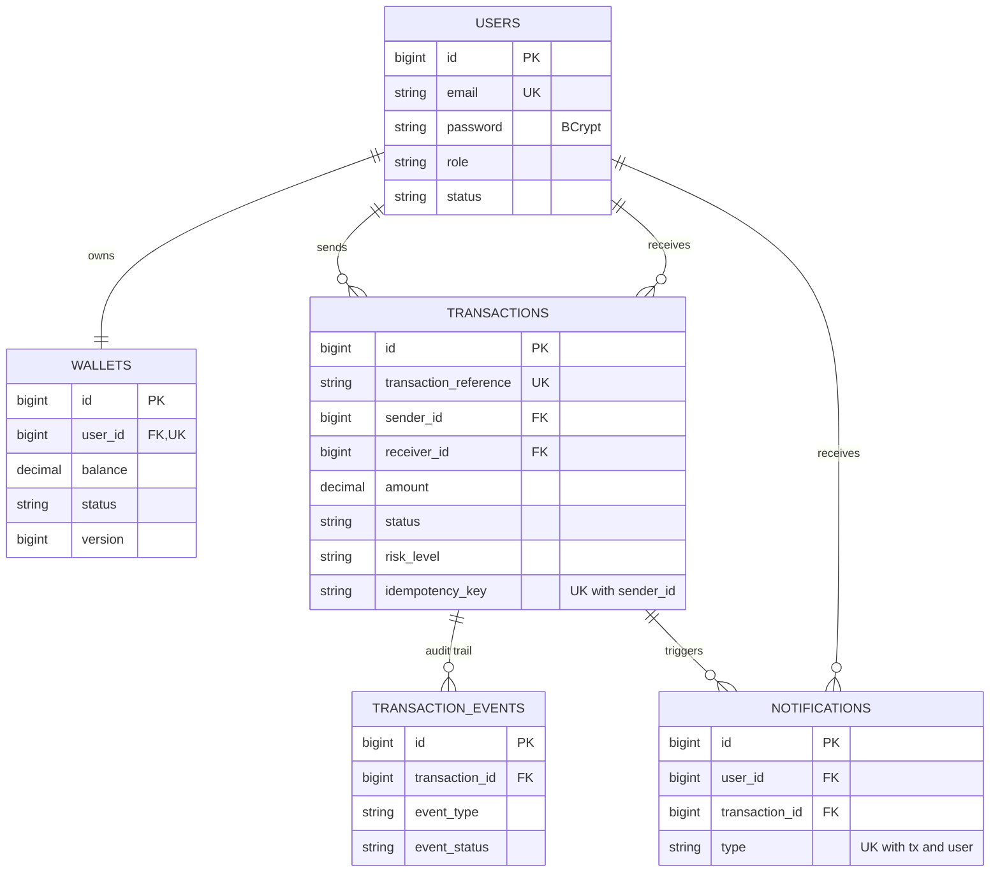

# Smart Payment Transaction Platform

A full-stack digital wallet and payment platform built around the hard parts of real payment systems:
**idempotent payments, an explicit transaction lifecycle, rule-based fraud/risk checks, Kafka-driven
notifications with retries, and transaction analytics.** Spring Boot 3 + MySQL + Kafka on the backend, React on the front.

> Built as a portfolio project. Money is simulated: no real payment gateway is connected.

## Problem statement

A naive "send money" endpoint has well-known failure modes: a double-clicked button or a client retry charges the user
twice, two simultaneous payments overdraw a wallet, a failed payment leaves no trace, and a slow notification service
blocks the payment itself. This project solves each one deliberately:

| Problem | Solution in this codebase |
|---|---|
| Duplicate charges on retry | `Idempotency-Key` header + `UNIQUE(sender_id, idempotency_key)` |
| Overdrawn wallets / races | Pessimistic row locks (`SELECT … FOR UPDATE`), ordered to avoid deadlocks, plus domain rule that balance cannot go negative |
| Lost failure information | Each stage commits separately; failures are stored as `FAILED` transactions with a reason and an event timeline |
| Risky transfers | Pluggable rule engine (limits, velocity, self-transfer, account status, repeat receiver) producing LOW/MEDIUM/HIGH/BLOCKED |
| Slow side effects blocking payments | Notifications handled asynchronously through Kafka, with retries and a dead-letter topic |

## Features

- Register / login with BCrypt-hashed passwords and **JWT** authentication, roles `USER` and `ADMIN`
- Wallet with balance lookup, **add money**, **send money**, receive money
- Transaction lifecycle `PENDING → PROCESSING → SUCCESS | FAILED` with an audit **timeline** per transaction
- **Idempotent** payments and top-ups
- **Fraud / risk engine** with configurable limits (`payment.*` properties)
- **Kafka** events (`payment-created`, `payment-completed`, `payment-failed`, `notification-events`) + consumers
- Paginated, searchable, filterable, sortable transaction history
- **Analytics**: totals, success/failure rate, today's activity, status split, daily series (user and admin views)
- Admin **monitoring** dashboard: users, volume, failures, recent and high-risk transactions
- Swagger UI, global exception handling, Bean Validation, structured logging
- Responsive React UI (desktop, tablet, phone)

## Architecture



Layers: `controller → service → repository → entity`, with `dto`, `mapper`, `security`, `exception`, `config`, `kafka`, `event`, `util`.
Controllers only translate HTTP; all rules live in services. Entities never leave the service layer: controllers return DTOs.

### Transaction flow



Status lifecycle:



`CANCELLED` and `REVERSED` exist in the enum for future cancel/refund features; no endpoint produces them yet.

## Technology stack and why

| Technology | Purpose here |
|---|---|
| Java 17, Spring Boot 3.3 | Production-standard backend framework: dependency injection, auto-configuration, one deployable jar |
| REST + JSON | Simple, stateless contract that any client (the React app, mobile, Postman) can use |
| Spring Security + JWT | Stateless auth: the token carries identity, so no server-side session and easy horizontal scaling |
| Spring Data JPA / Hibernate | Maps tables to objects, gives pagination, specifications, locking, auditing without boilerplate SQL |
| MySQL | Relational ACID store: payments need transactions, constraints, and row locks |
| Kafka | Decouples payment processing from side effects (notifications); durable, replayable, retryable |
| Bean Validation | Rejects bad input at the edge with field-level messages |
| springdoc-openapi | Generates Swagger UI from the code |
| JUnit 5 + Mockito, H2 | Unit tests with mocks; integration tests through the full Spring context |
| React, React Router, Axios, Recharts | SPA UI, routing, HTTP with JWT interceptor, charts |
| Docker Compose | One command to run MySQL + Kafka + backend + frontend |

## Project structure

```text
smart-payment-platform/
├── backend/
│   ├── pom.xml, Dockerfile
│   └── src/main/java/com/smartpay/platform/
│       ├── config/       AppConfig, SecurityConfig, OpenApiConfig, PaymentProperties, JwtProperties, DataSeeder
│       ├── controller/   Auth, User, Wallet, Payment, Transaction, Analytics, Notification, Admin
│       ├── dto/          request/response records, ApiResponse, ErrorResponse, PageResponse
│       ├── entity/       User, Wallet, Transaction, TransactionEvent, Notification + enums
│       ├── event/        PaymentCreated/Completed/Failed events, NotificationEvent (also the Kafka payloads)
│       ├── exception/    domain exceptions + GlobalExceptionHandler
│       ├── kafka/        topics, publisher, dispatcher, consumers, KafkaConfig (topics, retry, DLT)
│       ├── mapper/       entity → DTO mappers
│       ├── repository/   Spring Data repositories + projections
│       ├── security/     JwtService, JwtAuthenticationFilter, UserPrincipal, entry point / denied handler
│       ├── service/      PaymentService, PaymentProcessor, IdempotencyService, FraudDetectionService,
│       │   └── fraud/    FraudRule + one class per rule
│       └── util/         reference generator, JPA specifications
├── frontend/             Vite + React app, Dockerfile, nginx.conf
├── database/schema.sql   reference DDL
├── docs/                 architecture, API, database notes
├── docker-compose.yml, .env.example, .gitignore, LICENSE
```

## Database design



Key points (full DDL in [`database/schema.sql`](database/schema.sql), notes in [`docs/database.md`](docs/database.md)):
`UNIQUE(sender_id, idempotency_key)` is the duplicate-payment guarantee; composite indexes on `(sender_id, created_at)` and
`(receiver_id, created_at)` serve history, velocity and daily-limit queries; money is `DECIMAL(19,2)`, never floating point;
a wallet has a `version` column and a `CHECK (balance >= 0)` in the reference DDL. Relationships are unidirectional
(`Transaction → User`, `TransactionEvent → Transaction`, …) so serialization can never loop.
For a top-up, `sender = receiver = the wallet owner` (type `ADD_MONEY`), which lets top-ups reuse the same idempotency constraint.

## Idempotency

**Problem:** the network is unreliable. If a client times out, it cannot know whether the server processed the payment, so it
retries, and without protection the user is charged twice.

**Mechanism:** every `POST /api/payments` and `POST /api/wallet/add-money` must carry `Idempotency-Key: <unique value>`
(the React app sends a UUID).

1. `IdempotencyService` looks up `(sender_id, idempotency_key)`.
2. **Found, same payload** → no new transaction; the original is returned with HTTP **200** and header `Idempotent-Replayed: true`
   (`idempotentReplay: true` in the body). A first-time success returns **201**.
3. **Found, different payload** (same key, different receiver/amount) → HTTP **409**: that is a client bug, not a retry.
4. **Not found** → create the transaction. If two identical requests race past step 1, the database `UNIQUE` constraint lets exactly
   one insert succeed; the loser catches `DataIntegrityViolationException` and is treated as a replay of the winner.

Keys are scoped per user, so one user's key can never collide with another's. The frontend keeps the same key while retrying an
identical payload after a network failure, and creates a new one once the server has given a definite answer.

```bash
curl -X POST localhost:8080/api/payments -H "Authorization: Bearer $TOKEN" \
  -H "Idempotency-Key: TXN-123456" -H "Content-Type: application/json" \
  -d '{"receiverEmail":"bob@example.com","amount":250.00,"description":"Lunch"}'
# run it twice: the second call returns the same transaction and the balance changes only once
```

## Fraud / risk detection

Rule-based, no ML. Each rule is a small `@Component` implementing `FraudRule`; `FraudDetectionService` runs all of them and
keeps the **highest** severity. Adding a rule means adding a class; nothing else changes.

| Rule | Triggers | Result |
|---|---|---|
| `SelfTransferRule` | sender == receiver | BLOCKED |
| `AccountStatusRule` | sender or receiver not ACTIVE | BLOCKED |
| `AmountThresholdRule` | amount > `max-transaction-limit` / ≥ 80% of it / ≥ `medium-risk-threshold` | BLOCKED / HIGH / MEDIUM |
| `DailyLimitRule` | today's successful transfers + this one > `daily-limit` | BLOCKED |
| `VelocityRule` | prior attempts in the window ≥ `velocity-limit` / one below it | BLOCKED / MEDIUM |
| `RepeatedReceiverRule` | ≥ `repeat-receiver-limit` recent payments to the same receiver | HIGH |

`BLOCKED` → payment fails (HTTP 422, stored as `FAILED`, funds untouched). `HIGH`/`MEDIUM` → payment proceeds but is flagged and
appears in the admin "suspicious" list. All thresholds are configuration:

```properties
payment.max-transaction-limit=50000
payment.daily-limit=100000
payment.velocity-limit=5
payment.velocity-window-minutes=10
payment.medium-risk-threshold=20000
payment.repeat-receiver-limit=3
```

The processor also checks user/wallet status *before* the balance check (matching the required flow), so a frozen wallet or
inactive receiver is reported as an invalid transaction; `AccountStatusRule` is the same rule expressed as risk, kept so
the rule engine is complete on its own.

## Kafka architecture

| Topic | Producer | Consumer | Purpose |
|---|---|---|---|
| `payment-created` | `PaymentEventDispatcher` | `PaymentEventConsumer.onCreated` | audit / future analytics hook (logged) |
| `payment-completed` | `PaymentEventDispatcher` | `PaymentEventConsumer.onCompleted` | builds `PAYMENT_SENT`, `PAYMENT_RECEIVED`, `WALLET_TOPUP` notifications |
| `payment-failed` | `PaymentEventDispatcher` | `PaymentEventConsumer.onFailed` | builds a `PAYMENT_FAILED` notification |
| `notification-events` | `PaymentEventConsumer` | `NotificationConsumer` | stores the notification (delivery is simulated by a log line) |
| `<topic>.DLT` | error handler | — | dead-letter topic for each of the above |

- **Publish after commit.** The processor publishes Spring events; `PaymentEventDispatcher` uses
  `@TransactionalEventListener(AFTER_COMMIT)`, so a rolled-back payment never emits a message.
- **Ordering.** The record key is the transaction reference, so all events of one payment share a partition (topics have 3).
- **Producer:** `acks=all`, idempotent producer enabled, JSON serialization, bounded `max.block.ms` so a broker outage fails fast.
- **Consumers:** JSON with `ErrorHandlingDeserializer`; trusted package restricted to `com.smartpay.platform.event`.
- **Why it helps:** the payment API answers as soon as the database commit succeeds; notifications are processed independently,
  can be retried, scaled by adding consumers, and a slow or failing notifier can never fail a payment.

### Retry handling

`KafkaConfig` installs a `DefaultErrorHandler` for every listener: a failing record is retried **3 times, 1 second apart**
(`app.kafka.max-retries`, `app.kafka.retry-interval-ms`), then published to `<topic>.DLT` and skipped, so one poison message cannot block a
partition. Because delivery is at-least-once, `NotificationService` is **idempotent** (existence check backed by
`UNIQUE(transaction_id, user_id, type)`). Inspect dead letters with
`kafka-console-consumer --bootstrap-server localhost:9092 --topic payment-completed.DLT --from-beginning`.
Payment HTTP requests themselves are not auto-retried by the server; safe client retries are what idempotency is for.

## API documentation

Swagger UI: **http://localhost:8080/swagger-ui.html** (Docker: also http://localhost:3000/swagger-ui.html).
Log in via `POST /api/auth/login`, click **Authorize**, paste `data.token`.

| Method | Path | Auth | Description |
|---|---|---|---|
| POST | `/api/auth/register` | public | create account + empty wallet |
| POST | `/api/auth/login` | public | returns JWT |
| GET | `/api/users/me` | user | profile |
| GET | `/api/wallet` | user | wallet and balance |
| POST | `/api/wallet/add-money` | user | top-up (`Idempotency-Key` required) |
| POST | `/api/payments` | user | send money (`Idempotency-Key` required) |
| GET | `/api/payments/{id}` · `/reference/{ref}` | user | payment with event timeline |
| GET | `/api/payments/history` | user | paginated history |
| GET | `/api/transactions` | user | list; `status`, `search`, `from`, `to`, `page`, `size`, `sortBy`, `direction` |
| GET | `/api/transactions/{id}` · `/status/{status}` | user | detail / by status |
| GET | `/api/analytics/me` | user | my analytics (`days`, default 7) |
| GET | `/api/notifications` | user | my recent notifications |
| GET | `/api/admin/users` | admin | users (`search`, paging) |
| GET | `/api/admin/transactions` | admin | all transactions (adds `riskLevel` filter) |
| GET | `/api/admin/analytics` | admin | platform analytics, recent + high-risk transactions |

Responses use one envelope: `{ "success": true, "message": "...", "data": { } }`; errors:
`{ "success": false, "message": "Insufficient wallet balance", "timestamp": "...", "path": "/api/payments", "transactionReference": "TXN-…" }`
(validation errors add an `errors` map). Status codes: 400 validation/invalid, 401 not authenticated, 403 forbidden,
404 not found, 409 conflict (duplicate email, key reuse), 422 insufficient balance / blocked by risk rules, 500 unexpected.
More detail and examples in [`docs/api.md`](docs/api.md).

## Screenshots

> Add your own after running the app. Suggested files in `docs/screenshots/`.

| Login | Dashboard | Send money |
|---|---|---|
| _login.png_ | _dashboard.png_ | _send-money.png_ |

| Transactions | Transaction timeline | Admin monitor |
|---|---|---|
| _transactions.png_ | _details.png_ | _admin.png_ |

## Setup

Prerequisites: JDK 17+, Maven 3.9+, Node 20+, and MySQL 8 + Kafka (easiest via Docker).

### Option A: everything in Docker (recommended)

```bash
cp .env.example .env          # then edit the CHANGE-ME values (JWT_SECRET: openssl rand -base64 48)
docker compose up --build
```

| Service | URL |
|---|---|
| App | http://localhost:3000 |
| Swagger UI | http://localhost:3000/swagger-ui.html (or :8080) |
| API | http://localhost:8080 |
| MySQL | localhost:3306 |
| Kafka (from host) | localhost:9092 |

First start takes a few minutes (image pulls + Maven build). `APP_SEED_ENABLED=true` loads the demo users below.
Reset everything with `docker compose down -v`.

### Option B: develop locally

```bash
# 1. infrastructure only
cp .env.example .env                       # set DB_PASSWORD, MYSQL_ROOT_PASSWORD, JWT_SECRET
docker compose up -d mysql zookeeper kafka

# 2. backend (reads ../.env automatically; profile "dev" seeds demo data)
cd backend
SPRING_PROFILES_ACTIVE=dev mvn spring-boot:run     # http://localhost:8080

# 3. frontend (proxies /api to :8080)
cd ../frontend
npm install
npm run dev                                         # http://localhost:5173
```

No broker handy? Set `KAFKA_ENABLED=false`: payments work, events are only logged and notifications are not created.
`createDatabaseIfNotExist=true` creates the schema's database; Hibernate creates the tables on first start (`ddl-auto=update`).

### Environment variables

| Variable | Required | Default | Meaning |
|---|---|---|---|
| `DB_PASSWORD` | yes | — | MySQL user password |
| `JWT_SECRET` | yes | — | HMAC secret, ≥ 32 characters (app refuses to start otherwise) |
| `MYSQL_ROOT_PASSWORD` | Docker | — | MySQL root password |
| `DB_USERNAME`, `MYSQL_DATABASE` | no | `smartpay` | DB user and name |
| `DB_URL` | no | local MySQL URL | JDBC URL (set by compose) |
| `JWT_EXPIRATION_MINUTES` | no | `60` | token lifetime |
| `SPRING_PROFILES_ACTIVE` | no | `dev` | `dev` or `prod` |
| `APP_SEED_ENABLED` | no | `true` in dev | load demo data when DB is empty |
| `APP_TIMEZONE` | no | `Asia/Kolkata` | defines "today" for limits and analytics |
| `CORS_ALLOWED_ORIGINS` | no | localhost:3000, 5173 | comma-separated |
| `KAFKA_BOOTSTRAP_SERVERS` / `KAFKA_ENABLED` | no | `localhost:9092` / `true` | broker address / switch |
| `PAYMENT_*` | no | see above | risk-rule thresholds |

## Test credentials (demo data only)

| Role | Email | Password | Notes |
|---|---|---|---|
| Admin | `admin@smartpay.dev` | `Admin@123` | monitoring dashboard |
| User | `alice@example.com` | `User@1234` | seeded balance ₹24,250 |
| User | `bob@example.com` | `User@1234` | ₹11,300 |
| User | `charlie@example.com` | `User@1234` | ₹5,450 |
| User (inactive) | `dave.inactive@example.com` | `User@1234` | payments to him fail: demonstrates the account-status check |

The seeder (`DataSeeder`) only runs when `app.seed.enabled=true` **and** the database has no users, and adds 15 back-dated sample
transactions (successes, failures, medium/high/blocked risk). Seeded balances are final figures; the sample history is illustrative.
All data is fictional. **Change or disable seeding for anything beyond a demo.**

Try these: send ₹60,000 (blocked: over limit), send ₹100 to Dave (fails: inactive), send to your own email (blocked: self transfer),
send 6 payments within 10 minutes (blocked: velocity), repeat a payment with the same key (replayed, charged once).

## Testing

```bash
cd backend && mvn verify          # unit + integration tests (H2 in memory, Kafka off; no Docker needed)
cd frontend && npm run build      # type-free compile check of the UI bundle
```

| Test class | Covers |
|---|---|
| `PaymentServiceTest` | success pipeline order, duplicate key replay, key reuse conflict, lost race, invalid receiver, failure propagation, stuck-transaction rescue |
| `PaymentProcessorTest` | wallet debit/credit, insufficient balance, fraud block, HIGH risk allowed, inactive receiver, frozen wallet, top-up, compare-and-set |
| `FraudDetectionServiceTest` | every rule and severity aggregation |
| `WalletTest` | balance never negative |
| `JwtServiceTest` | token round-trip, tampering, wrong secret, expiry, weak secret |
| `AuthServiceTest` | hashing, role assignment, duplicate email, login |
| `AuthIntegrationTest` | register/login/profile, validation errors, 401, 403 for USER on admin APIs, admin access, blocked user |
| `PaymentFlowIntegrationTest` | end-to-end HTTP: balances, idempotency (201 → 200), 409, 404, 422, ownership 403, analytics |

## Design notes for interviews

- **Why separate transactions per stage?** If the whole payment were one `@Transactional`, a failed check would roll back the very
  record explaining the failure. Splitting into `createPending` / `startProcessing` / `execute` makes `PENDING`, `PROCESSING` and
  `FAILED` durable and observable. `PaymentService` is deliberately not transactional and calls a *different* bean so Spring's proxy applies.
- **How are double spends prevented?** Wallet rows are locked with `SELECT … FOR UPDATE` in ascending id order (no deadlocks between
  A→B and B→A), the balance is checked under the lock, and the debit happens in the same transaction.
- **Why `BigDecimal`?** Floating point cannot represent money exactly.
- **Why JWT?** Stateless: any instance can verify a token. The filter re-loads the user each request, so blocking a user takes effect immediately.
- **Why Kafka and not a method call?** Notifications are a side effect: they should not add latency or failure modes to a payment.
- **How would this scale?** Stateless API instances behind a load balancer; MySQL read replicas for history/analytics; more Kafka
  partitions and consumers; cache hot reads; move analytics to pre-aggregated tables.

## Known limitations

- **No transactional outbox.** Events are sent after commit; if Kafka is down at that moment the event is logged and lost (the payment is
  still correct). An outbox table + relay would make delivery guaranteed.
- Top-ups are simulated (no gateway); notifications are stored but not emailed/SMSed.
- `CANCELLED` / `REVERSED` statuses are defined but there is no cancel/refund flow yet.
- No refresh tokens, rate limiting, or account lock-out after failed logins.
- Schema is managed by Hibernate `ddl-auto`; use Flyway/Liquibase for production.
- Analytics read the last N days of rows and aggregate in memory by day; fine for demo scale, use SQL aggregation/rollups at scale.

## Future enhancements

Transactional outbox · cancel/refund flows · Flyway migrations · refresh tokens + rate limiting · email/SMS providers ·
Testcontainers integration tests (real MySQL + Kafka) · Prometheus/Grafana metrics · Redis cache · admin controls to block/unblock users.

## Suggested commits

`chore: scaffold spring boot + maven` → `feat: user, wallet entities and JWT security` → `feat: payment pipeline with wallet locking` →
`feat: idempotency keys` → `feat: rule-based fraud engine` → `feat: kafka events, consumers, retries and DLT` → `feat: analytics endpoints` →
`feat: react app (auth, wallet, payments, history)` → `feat: admin monitor` → `test: unit and integration tests` → `chore: docker compose` → `docs: readme and diagrams`

## License

MIT, see [LICENSE](LICENSE).
