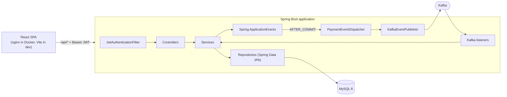

# Architecture

## Components

## Request path (a payment)

1. `JwtAuthenticationFilter` verifies the bearer token and loads the user (blocked users are rejected here).
2. `PaymentController` validates the body (`@Valid`) and passes the `Idempotency-Key` header to `PaymentService`.
3. `PaymentService` (not transactional) orchestrates; each step is its own transaction in `PaymentProcessor`:
   `createPending` → `startProcessing` → `execute` (status/balance/fraud checks, wallet movement, final status).
4. Domain events are published as Spring events inside the transaction and forwarded to Kafka only after commit.
5. Consumers turn events into notifications; the UI shows them on the dashboard.

## Why these boundaries

| Decision | Reason |
|---|---|
| `PaymentService` is not `@Transactional` | each lifecycle stage must commit independently so `PENDING`/`PROCESSING`/`FAILED` are durable |
| `PaymentProcessor` is a separate bean | Spring transactions work through proxies; a self-call would silently skip them |
| Business failures return an outcome instead of throwing inside the transaction | throwing would roll back the `FAILED` record; the exception is re-thrown after commit |
| Wallet lock order = ascending user id | prevents deadlocks between opposite concurrent transfers |
| `status` compare-and-set update | guarantees only one worker processes a transaction |
| `AFTER_COMMIT` publishing | no Kafka message for a rolled-back payment |
| Idempotent consumer (unique constraint) | Kafka is at-least-once, so duplicates must be harmless |
| DTO records + mappers | API contract independent of the schema; no lazy-loading or serialization leaks |
| `FraudRule` strategy interface | rules are independent, individually testable, and added without modifying existing code |

## Failure handling matrix

| Failure | Result |
|---|---|
| Invalid body / missing header | 400, nothing created |
| Unknown receiver | 404, nothing created |
| Same key, same payload | 200 replay of original |
| Same key, different payload | 409, nothing created |
| Insufficient balance / risk block / inactive account | transaction stored as `FAILED` with reason; 422 or 400 with the reference |
| Unexpected exception during processing | `markFailed` moves it to `FAILED`; 500 returned |
| Kafka down after commit | payment stays correct; event logged as unpublished (see outbox in future work) |
| Consumer error | 3 retries, 1 s apart, then `<topic>.DLT` |

## Scaling notes

The API is stateless (JWT), so it scales horizontally. Contention is limited to the two wallet rows involved in a payment.
Kafka topics have 3 partitions keyed by transaction reference, so consumers scale to 3 instances per group with per-payment ordering.
Next steps for real scale: read replicas for history, pre-aggregated analytics, a transactional outbox, and Redis for hot reads.
